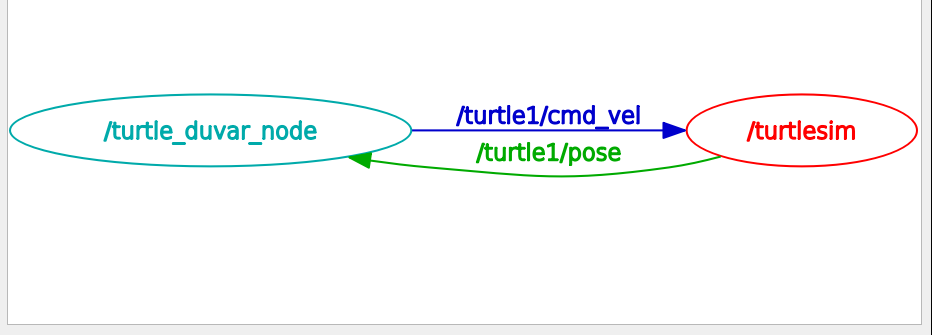
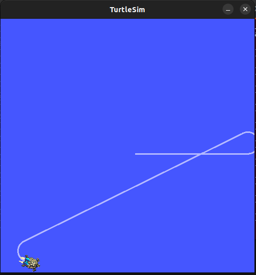
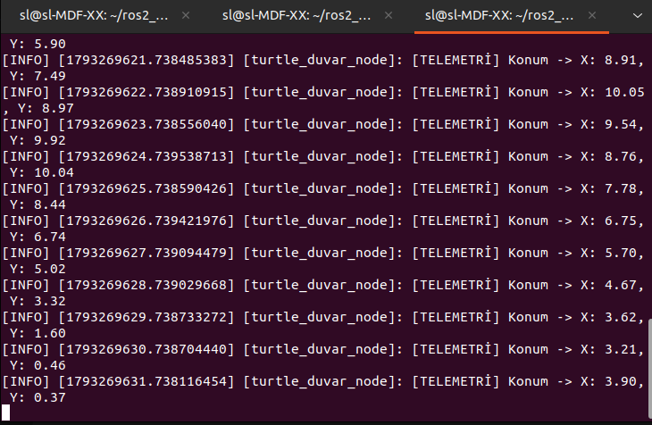
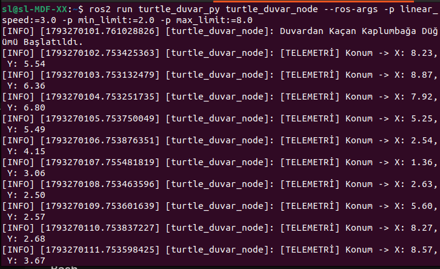

# ROS 2 Ortamında Otonom Duvardan Kaçan Kaplumbağa Kontrolcüsü

**Yazar:** Işıl Yüksel Tosun  
**Bölüm:** Yazılım Mühendisliği  
**ROS 2 Sürümü:** ROS 2 Humble Hawksbill  
**Paket Adı:** `turtle_duvar_py`  

---

## Özet
Bu proje, ROS 2 Humble ortamında `turtlesim` simülasyonu için geliştirilmiş otonom bir duvar kaçış kontrol düğümüdür (`turtle_duvar_node`). Düğüm, `/turtle1/pose` konusundan (topic) anlık konum verilerini dinler ve kaplumbağanın belirlenen sınırlar ($1.0 \le x, y \le 10.0$) dışına çıkmasını engellemek için `/turtle1/cmd_vel` konusuna hız komutları yayınlar. Ayrıca sistem, hızı ve sınır değerlerini dinamik olarak değiştirebilen ROS 2 parametre yapısına ve saniyede bir (1 Hz) telemetri yazdıran loglama mekanizmasına sahiptir.

---

## I. Sistem Mimarisi ve Çalışma Mantığı

Sistem iki ana zamanlayıcı (timer) döngüsü üzerinden kapalı devre çalışmaktadır:
1. **Kontrol Döngüsü (10 Hz):** Konum sınırlarını sürekli denetler; sınıra ulaşıldığında kavisli dönüş, güvenli alandayken düz ileri hareket komutu üretir.
2. **Telemetri Log Döngüsü (1 Hz):** `get_logger().info()` fonksiyonunu kullanarak saniyede bir defa $x$ ve $y$ koordinatlarını terminale yazdırır.

### Hareket Kontrol Mantığı
Düğümün karar mekanizması şu matematiksel koşula dayanır:

$$\text{Komut} = \begin{cases} 
\text{Kavisli Dönüş } (v_x = 0.4 \cdot v_{\text{hız}}, \omega_z = \omega_{\text{hız}}), & \text{eğer } x < x_{\text{min}} \lor x > x_{\text{max}} \lor y < y_{\text{min}} \lor y > y_{\text{max}} \\ 
\text{Düz İleri Hareket } (v_x = v_{\text{hız}}, \omega_z = 0), & \text{aksi takdirde} 
\end{cases}$$

---

## II. Deneysel Sonuçlar ve Ekran Görüntüleri

### A. Düğüm İletişim Grafiği (`rqt_graph`)

> **Görsel Açıklaması:** `rqt_graph` aracı ile alınan bu görselde, geliştirilen `turtle_duvar_node` düğümünün `/turtle1/pose` konusuna abone olduğu ve `/turtle1/cmd_vel` konusuna hız verileri yayınlayarak `turtlesim` simülatörü ile çift yönlü haberleştiği doğrulanmaktadır.

### B. Yörünge ve Duvardan Kaçış Testi

> **Görsel Açıklaması:** Kaplumbağanın $1.0$ ve $10.0$ duvar sınırlarına yaklaştığında duvara sıkışmadan kavis çizerek güvenli alana geri döndüğünü ve ekranda bıraktığı izle kaçış yörüngesini kanıtlayan simülasyon ekran görüntüsüdür.

### C. Saniyelik Telemetri Log Çıktısı (1 Hz)

> **Görsel Açıklaması:** Düğüm çalışırken `get_logger().info()` yardımıyla terminal ekranına her saniye (1 Hz) düzenli olarak basılan anlık X ve Y konum telemetri verilerini göstermektedir.

### D. Dinamik Parametre Testi (Bonus Özellik)

> **Görsel Açıklaması:** Düğümün kod içine sabit sayılar gömmek yerine, komut satırından `--ros-args -p linear_speed:=...` parametreleri ile istenilen hız ve sınır değerleriyle dinamik olarak başlatılabildiğini gösteren terminal ekran görüntüsüdür.

---

## III. Kurulum ve Çalıştırma

### Paketi Derleme
```bash
cd ~/ros2_ws/src
git clone [https://github.com/isilyuksel-tosun/turtle_duvar_py.git](https://github.com/isilyuksel-tosun/turtle_duvar_py.git)
cd ~/ros2_ws
colcon build --packages-select turtle_duvar_py
source install/setup.bash
